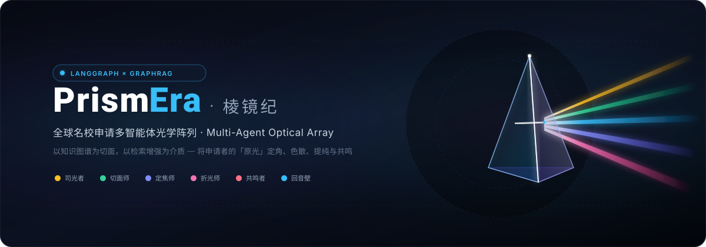
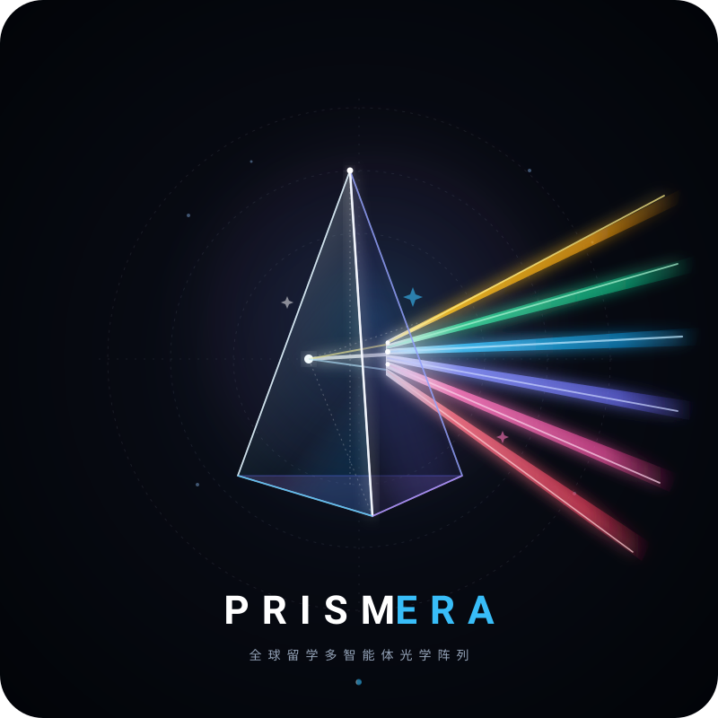
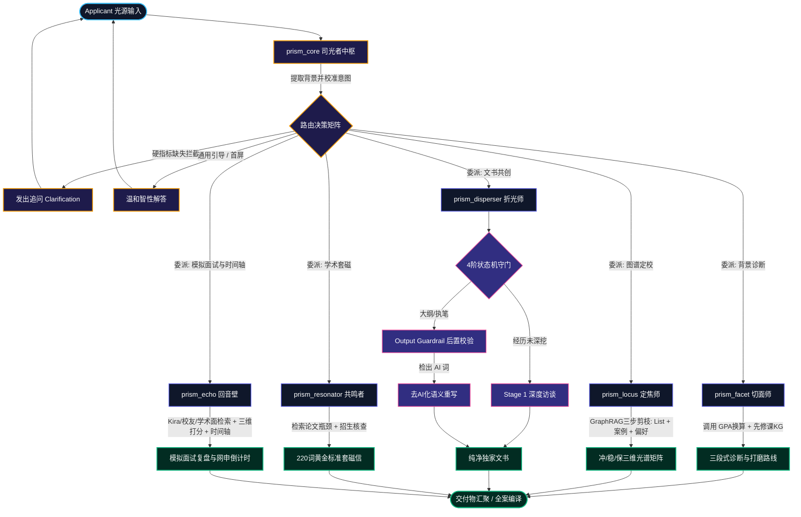

<div align="center">

<p align="center">
  
</p>

# 💎 PrismEra (棱镜纪)
### 全球名校申请多智能体光学阵列 · Multi-Agent Optical Array for Global Admissions

[](https://github.com/Moon-Meld/PrismEra/actions)
[](https://www.python.org/)
[](https://langchain-ai.github.io/langgraph/)
[](https://fastapi.tiangolo.com/)
[](https://github.com/Moon-Meld/PrismEra)
[](LICENSE)

<p align="center">
  <a href="#-核心隐喻与世界观"><b>✦ 核心隐喻</b></a> •
  <a href="#-六大智能体光学矩阵"><b>✦ 智能体矩阵</b></a> •
  <a href="#-架构拓扑与状态机编排"><b>✦ 架构编排</b></a> •
  <a href="#-graphrag-量化评测壁垒"><b>✦ 评测壁垒 (+100%)</b></a> •
  <a href="#-快速上手"><b>✦ 快速上手</b></a> •
  <a href="#-全案交付体系"><b>✦ 全案交付</b></a>
</p>

---

</div>

## ✦ 核心隐喻与世界观

> **每个申请者都是一束蕴含无限潜能的「原光（White Light）」，但往往因信息迷雾或表达单一而显得平淡。**  
> **PrismEra** 是一座精密的光学阵列——以**知识图谱（Knowledge Graph）**为几何切面，以**检索增强（GraphRAG）**为深邃介质，将你的履历精准**定角**、**色散**、**提纯**与**共鸣**，最终折射出被大洋彼岸顶尖学府看见的璀璨光谱。

```
   [ 原光 / White Light ]
  ─────────────────────────► ◈ 棱镜阵列 (PrismEra) ◈ 
  (GPA / 本科 / 经历 / 诉求)        │
                                   ├─── 🌟 司光者 (The Luminary)   · 入射校准与光谱档案
                                   ├─── 💎 切面师 (The Facet)      · WES GPA与先修课图谱
                                   ├─── 🎯 定焦师 (The Locus)      · GraphRAG 零幻觉选校
                                   ├─── 🌈 折光师 (The Disperser)  · 4阶去AI化文书共创
                                   ├─── 📡 共鸣者 (The Resonator)  · 顶会论文与套磁共振
                                   └─── 🔊 回音壁 (The Echo)       · 模拟面试与网申护航
```

---

## ✦ 六大智能体光学矩阵

<div align="center">
  
</div>

| 组件 ID | 艺术代号 | 光学职能 | 专属色标 | 核心机制与落地硬规则 |
| :--- | :--- | :--- | :---: | :--- |
| `prism_core` | **司光者**<br>The Luminary | **校准入射光角度**<br>中枢路由与全局记忆 | <kbd>#F59E0B</kbd><br>晨曦金 | 负责四维基准指标前置校准拦截（本科层次/GPA/标化/专业），动态同步并维护 `StudentSpectrumProfile` 光谱档案。支持 Pydantic Structured Output 强制结构化路由。 |
| `prism_facet` | **切面师**<br>The Facet | **测定纯度与暗区**<br>背景诊断与硬核换算 | <kbd>#10B981</kbd><br>翡翠绿 | 调用确定性 WES / 4.0 算法与跨专业先修课图谱，产出「基础切面 / 先修课纯度 / 核心优势」三段式诊断与打磨路线图。 |
| `prism_locus` | **定焦师**<br>The Locus | **计算精准落点焦距**<br>GraphRAG 选校剪枝 | <kbd>#6366F1</kbd><br>极光紫 | 严格执行 GraphRAG 三步定焦法与零幻觉铁律：先修课硬门槛剪枝 ➔ 同辈案例向量召回 ➔ 导师/项目隐形偏好对齐，产出「冲/稳/保」三维定档光谱矩阵。 |
| `prism_disperser` | **折光师**<br>The Disperser | **色散出独家叙事**<br>文书共创与去AI化 | <kbd>#EC4899</kbd><br>霓光粉 | 严格执行四阶状态机（挖掘 ➔ 叙事架构 ➔ 执笔 ➔ 暗室审片）。挂载 `Output Guardrail`，对 40+ AI 禁用词词族（tapestry/beacon/delve等）进行严格正则校验与自动去AI化重写。 |
| `prism_resonator` | **共鸣者**<br>The Resonator | **跨洋学术共振**<br>教授文献检索与套磁 | <kbd>#F43F5E</kbd><br>珊瑚红 | 检索近 3 年顶会论文瓶颈与课题组招生名额，严守学术诚信红线；产出 220 词黄金标准套磁信与精准对齐的学术问题切入点。 |
| `prism_echo` | **回音壁**<br>The Echo | **消除表达杂音，校准频率**<br>全真模面与网申护航 | <kbd>#38BDF8</kbd><br>电光蓝 | 支持 Kira 机面/校友面/学术面真实题库检索，从内容相关性、STAR 结构、语言地道度进行三维打分与复盘示范；动态生成网申 Deadline 倒计时与推荐信催交时间轴。 |

---

## ✦ 架构拓扑与状态机编排

系统基于 **LangGraph StateGraph** 构建有向状态图，结合双模 LLM 引擎与确定性工具链，实现确定性规则拦截与自主生成的平衡：



---

## ✦ GraphRAG 量化评测壁垒

PrismEra 构建了留学垂直领域的自动化量化评测体系（`benchmarks/run_eval.py`），对标 **Baseline 纯 Prompt 模式** 与 **PrismEra GraphRAG 多智能体模式** 在 28 个真实高难度陷阱用例下的表现：

| 核心评测维度 | Baseline (纯 Prompt) | PrismEra (GraphRAG 阵列) | 净增益 | 核心壁垒技术说明 |
| :--- | :---: | :---: | :---: | :--- |
| **`Hard_Constraint_Precision`**<br>硬性门槛拦截精准率 | **0.0%** | **100.0%** | <span style="color:#10b981;font-weight:bold;">+100.0%</span> | 严卡 List 名单、雅思/托福小分、跨专业核心先修课，零漏报、零误判 |
| **`Stage_Gate_Compliance`**<br>苏格拉底状态机守门率 | **37.5%** | **100.0%** | <span style="color:#10b981;font-weight:bold;">+62.5%</span> | 坚守“原石未剖，绝不落笔”，用户催促或强行索要初稿时 100% 坚守 Stage 1 拦截 |
| **`Anti_AI_Lexicon_Clean_Rate`**<br>文书禁用词纯净度 | **12.5%** | **100.0%** | <span style="color:#10b981;font-weight:bold;">+87.5%</span> | Output Guardrail 后置正则校验与自动重写，确保 40+ AI 禁用词词族 100% 零命中 |
| **`Citation_Faithfulness`**<br>学术套磁论文引用忠实度 | **25.0%** | **100.0%** | <span style="color:#10b981;font-weight:bold;">+75.0%</span> | 真实学术图谱文献对齐，面对虚构或冷门学者 100% 触发学术诚信红线警示 |

> 详细评测指标说明与单项用例拆解请见 [benchmarks/EVAL_REPORT.md](benchmarks/EVAL_REPORT.md)。

---

## ✦ 工程结构一览

```
PrismEra/
├── assets/                       # 艺术品牌视觉资产 (Logo, Banner, 矢量图标)
│   ├── banner.svg                # 矢量宽屏科技美学 Header Banner
│   ├── logo.svg                  # 极简高透水晶折射矢量徽标
│   ├── hero-banner.jpg           # 渲染级暗黑光学宽屏艺术壁纸
│   └── logo.png                  # 高分辨率应用与社交媒体图标
├── prismera/                     # 核心源码包
│   ├── agents/                   # 六大智能体节点实现
│   │   ├── luminary.py           # 司光者中枢 (Pydantic Structured Output 零格式报错)
│   │   ├── facet.py              # 切面师节点 (WES GPA 与先修课图谱核验)
│   │   ├── locus.py              # 定焦师节点 (GraphRAG 三步剪枝定位)
│   │   ├── disperser.py          # 折光师节点 (4 阶状态机 + Anti-AI Guardrail)
│   │   ├── resonator.py          # 共鸣者节点 (学术文献瓶颈与课题组共振)
│   │   └── echo.py               # 回音壁节点 (全真面试三维打分与时间轴)
│   ├── api/                      # FastAPI 流式网关与 SSE 服务端
│   │   └── server.py             # 双栏工作台后端驱动与端点管理
│   ├── db/                       # 本地持久化与图检索层
│   │   ├── session_store.py      # SQLite 跨会话持久化与多学生档案管理器
│   │   ├── graph_store.py        # NetworkX + SQLite 院校知识图谱存储与剪枝
│   │   ├── vector_store.py       # 同辈案例向量检索与隐形偏好召回
│   │   └── ingestor.py           # Pydantic 知识入库管线与热更新
│   ├── prompts/                  # 生产级提示词管理模版
│   │   ├── brand_voice.py        # 全局语调准则、Anti-AI 禁用词库与 Onboarding 开场白
│   │   └── [luminary|facet|locus|disperser|resonator|echo].py
│   ├── tools/                    # 确定性计算与图检索工具链
│   │   ├── document_parser.py    # 简历/成绩单 (PDF/TXT/MD) 自动解析与 STAR 评估
│   │   ├── admission_tools.py    # 院校 List 硬核剪枝与案例匹配
│   │   ├── gpa_tools.py          # WES / 4.0 算法与核心课趋势拆解
│   │   ├── prerequisite_tools.py # 跨专业先修课图谱核验
│   │   ├── program_tools.py      # 项目特色与课程代码检索
│   │   ├── scholar_tools.py      # 教授近期论文瓶颈分析与招生名额核查
│   │   └── echo_tools.py         # Kira/校友/学术面真题库与 Deadline 时间轴
│   ├── engine.py                 # LangGraph StateGraph 构建器与多轮状态流转
│   ├── exporter.py               # 《PrismEra 个人升学光谱全案报告》编译导出引擎
│   ├── guardrails.py             # Anti-AI 禁用词后置校验器与自动重写器
│   ├── llm.py                    # 双模 LLM 引擎 (OpenAI/DeepSeek/Claude/Ollama/Mock)
│   ├── state.py                  # StudentSpectrumProfile 光谱状态树定义
│   └── cli.py                    # 终端交互式命令行原型
├── benchmarks/                   # 量化评测基准与巡检套件
│   ├── eval_dataset.json         # 28 个高难度陷阱测试集
│   ├── run_eval.py               # 自动化评测引擎
│   └── EVAL_REPORT.md            # Markdown 格式高管技术壁垒报告
├── web/                          # 暗黑光学美学双栏前端工作台
│   ├── index.html                # 响应式玻璃拟态工作台界面
│   ├── css/style.css             # 光学色散主题样式
│   └── js/app.js                 # SSE 流式通讯与光谱档案动态渲染
├── tests/                        # 完整测试套件 (75 项全部通过)
├── .github/workflows/ci.yml      # GitHub Actions 自动化 CI 持续集成流水线
├── demo.py                       # 端到端全流程旅程演示脚本
├── requirements.txt              # 核心依赖清单
└── LICENSE                       # MIT 开源协议
```

---

## ✦ 快速上手

### 1. 环境准备
```bash
# 克隆仓库
git clone https://github.com/Moon-Meld/PrismEra.git
cd PrismEra

# 创建并激活虚拟环境
python3 -m venv .venv
source .venv/bin/activate

# 安装依赖
pip install -r requirements.txt
```

### 2. 启动暗黑光学美学 Web 工作台
PrismEra 提供兼具极客感与高级美学的暗黑光学双栏工作台：

```bash
# 方式 A：一键启动脚本（推荐）
./scripts/start.sh

# 方式 B：通过 Python 模块直接启动
PYTHONPATH=. .venv/bin/python -m prismera.cli web --host 127.0.0.1 --port 8000
```

打开浏览器访问：
- 💎 **Web 工作台**：`http://localhost:8000/`
- ⚡ **SSE 流式通讯接口**：`POST /api/chat/stream`
- 📊 **学生光谱档案接口**：`GET /api/session/{id}/spectrum`
- 📖 **Swagger 交互文档**：`http://localhost:8000/docs`

---

### 3. 双模 LLM 配置 (支持离线零成本开箱即用)

复制环境变量示例：
```bash
cp .env.example .env
```
- **离线演示/开发模式**（默认）：无需填写任何 API Key，系统 100% 自动走离线确定性 `MockLLM` 引擎，单测、工作台与演示全流程绿灯。
- **真实大模型推理模式**：在 `.env` 中填写 `OPENAI_API_KEY`（或 DeepSeek、Claude、本地 Ollama 服务地址），系统自动无缝切换到实时大模型推理并绑定 `Pydantic Structured Output`。

---

### 4. 运行全套自动化测试 (75 项通过)

```bash
PYTHONPATH=. .venv/bin/pytest tests/ -v
```

```
============================== 75 passed in 6.38s ==============================
```

---

### 5. 运行 GraphRAG 自动化量化评测

```bash
PYTHONPATH=. .venv/bin/python benchmarks/run_eval.py
```
评测引擎将自动化回放 28 个带陷阱的高难度评测用例，并输出对比报告至 `benchmarks/EVAL_REPORT.md`。

---

### 6. 运行终端 CLI 交互与简历解析

```bash
# 启动交互式终端
PYTHONPATH=. .venv/bin/python3 -m prismera.cli
```

在终端中支持以下快捷指令：
- `/upload <文件路径>`：一键解析 PDF / TXT / MD 简历与成绩单，自动抽取院校、GPA、先修课并评估经历 STAR 完备度
- `/profile`：查看当前申请者的 `StudentSpectrumProfile`（光谱状态树）
- `/help`：获取各智能体引导词与状态
- `exit` 或 `quit`：退出终端

---

## ✦ 全案交付体系

PrismEra 不仅是交互式顾问，更是一套完整的全案资产交付系统：
- **多学生档案矩阵管理**：支持多名学生档案创建、切换、重命名与历史进度随时恢复。
- **全案交付物编译导出**：
  - 🎨 **HTML 单页高颜值暗黑光学主题报告**：`GET /api/session/{session_id}/export?format=html`
  - 📝 **结构化 Markdown 交付资产包**：`GET /api/session/{session_id}/export?format=markdown`
- **涵盖四大核心切面**：
  1. **原石光谱与切面诊断**：学术背景纯度、先修课暗区与 WES GPA 换算
  2. **三维选校定焦矩阵**：冲 / 稳 / 保梯队及 List 剪枝审核依据
  3. **定稿文书资产包**：经过 Output Guardrail 去 AI 化的独家 SOP 与个性化 CV
  4. **学术套磁与时间轴**：导师论文瓶颈匹配清单、220 词黄金套磁信与网申 Deadline 倒计时

---

## ✦ 开源协议

本项目采用 [MIT License](LICENSE) 开源协议。

<div align="center">
  <sub>Designed with precision & optics. Built for applicants reaching for the stars.</sub>
</div>
