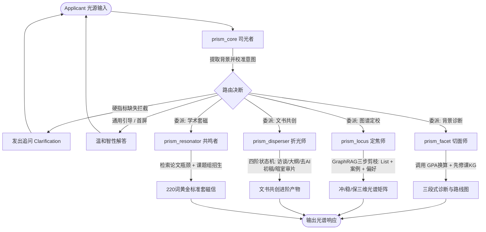

# PrismEra (棱镜纪) · 全球留学多智能体光学阵列

> **世界观设定**：每一个申请者都是一束蕴含无限潜能的“原光（White Light）”，但往往因信息迷雾或表达单一而显得平淡。**PrismEra** 是一座精密的光学阵列——通过知识图谱（KG）的几何切面与检索增强（RAG）的深邃介质，将你的履历精准定角、色散、提纯与共鸣，最终折射出被大洋彼岸顶尖学府看见的璀璨光谱。

---

## ✦ 智能体阵列角色映射

| 组件 ID | 艺术代号 | 核心职能 | 光学隐喻与落地规则 |
| :--- | :--- | :--- | :--- |
| `prism_core` | **司光者 / The Luminary** | 中枢路由、全局记忆维护、意图拆解 | **校准入射光角度**。负责四维基准指标前置校准拦截，动态更新学生光谱档案。 |
| `prism_facet` | **切面师 / The Facet** | 背景诊断、WES GPA换算、先修课图谱对齐 | **测定纯度与暗区**。调用确定性计算工具与先修课图谱，产出三段式诊断与打磨路线。 |
| `prism_locus` | **定焦师 / The Locus** | GraphRAG 选校定位、院校 List 剪枝 | **计算精准落点焦距**。严格执行 GraphRAG 三步定焦法与零幻觉铁律，生成三维定档矩阵。 |
| `prism_disperser` | **折光师 / The Disperser** | 苏格拉底式故事挖掘、文书(SOP/CV)共创 | **色散出独家叙事**。严格执行四阶状态机（挖掘->大纲->执笔->暗室审片），强制 Anti-AI 词汇黑名单。 |
| `prism_resonator` | **共鸣者 / The Resonator** | 教授文献检索、学术套磁、课题组匹配 | **跨洋学术共振**。检索近3年顶会论文瓶颈，严守学术诚信红线，产出 220 词黄金标准套磁信。 |

---

## ✦ 状态机编排架构 (LangGraph StateGraph)



---

## ✦ 工程目录结构

```
PrismEra/
├── prismera/
│   ├── __init__.py
│   ├── state.py                  # StudentSpectrumProfile & PrismEraState 核心状态定义
│   ├── config.py                 # 全局配置与模型环境参数
│   ├── engine.py                 # LangGraph StateGraph 构建器与多轮会话管理
│   ├── cli.py                    # 终端交互式命令行原型
│   ├── prompts/                  # 生产级提示词管理模版
│   │   ├── brand_voice.py        # 全局语调准则与 Onboarding 开场白
│   │   ├── luminary.py           # 司光者 (prism_core) 提示词
│   │   ├── facet.py              # 切面师 (prism_facet) 提示词
│   │   ├── locus.py              # 定焦师 (prism_locus) 提示词
│   │   ├── disperser.py          # 折光师 (prism_disperser) 提示词
│   │   └── resonator.py          # 共鸣者 (prism_resonator) 提示词
│   ├── tools/                    # 确定性工具链 (GraphRAG / KG比对 / 文献检索)
│   │   ├── gpa_tools.py          # WES / 4.0 算法与核心课趋势拆解
│   │   ├── prerequisite_tools.py # 跨专业先修课图谱核验
│   │   ├── admission_tools.py    # List硬核剪枝、同辈案例库与隐形偏好
│   │   ├── program_tools.py      # 项目培养使命、特色课程代码检索
│   │   └── scholar_tools.py      # 教授近期论文瓶颈分析与招生名额核查
│   └── agents/                   # 五大智能体节点实现
│       ├── luminary.py           # 中枢意图拆解与前置校准拦截
│       ├── facet.py              # 切面师执行节点
│       ├── locus.py              # 定焦师执行节点
│       ├── disperser.py          # 折光师 4 阶状态机节点
│       └── resonator.py          # 共鸣者学术共振节点
├── tests/                        # 完整单元与集成测试套件
│   ├── test_state.py
│   ├── test_tools.py
│   └── test_engine.py
├── demo.py                       # 7 步全流程端到端自动化演示脚本
├── requirements.txt
├── .env.example
└── README.md
```

---

## ✦ 快速上手指南

### 1. 激活虚拟环境与安装依赖
```bash
# 激活工程已就绪的虚拟环境
source .venv/bin/activate

# 或通过 pip 安装生产依赖
pip install -r requirements.txt
```

### 2. 运行全套自动化测试
```bash
PYTHONPATH=. .venv/bin/pytest tests/
```

### 3. 运行 7 阶端到端全流程模拟演示
```bash
PYTHONPATH=. .venv/bin/python3 demo.py
```

### 4. 启动交互式 CLI 终端体验
```bash
PYTHONPATH=. .venv/bin/python3 -m prismera.cli
```

在终端中可随时输入快捷指令：
- `/profile`：查看当前申请者的 Student Spectrum State（光谱状态树）
- `/help`：获取各智能体引导词
- `exit` 或 `quit`：退出终端
