<div align="center">

<p align="center">
  
</p>

# 💎 PrismEra (棱镜纪) · V1.0 全栈终极大案
### 全球名校升学多智能体暗黑光学阵列 · Multi-Agent Optical Array for Global Admissions

[](https://github.com/Moon-Meld/PrismEra/actions)
[-333333?style=for-the-badge&logo=apple&logoColor=white)](docs/DESKTOP_INSTALL.md)
[-0078d7?style=for-the-badge&logo=windows&logoColor=white)](docs/DESKTOP_INSTALL.md)
[](https://www.python.org/)
[](docker-compose.yml)
[](https://langchain-ai.github.io/langgraph/)
[](https://fastapi.tiangolo.com/)
[](https://github.com/Moon-Meld/PrismEra)
[](LICENSE)

<p align="center">
  <a href="#-原生桌面客户端下载与安装-windows--macos"><b>💻 桌面端下载</b></a> •
  <a href="#-核心隐喻与世界观"><b>✦ 核心隐喻</b></a> •
  <a href="#-五层全栈系统架构"><b>✦ 全栈架构</b></a> •
  <a href="#-六大光学智能体矩阵"><b>✦ 智能体矩阵</b></a> •
  <a href="#-棱镜控制台系统与图谱管理中心"><b>✦ 系统控制台</b></a> •
  <a href="#-graphrag-量化评测壁垒"><b>✦ 评测壁垒 (+100%)</b></a> •
  <a href="#-标准命令与快速上手"><b>✦ 快速上手</b></a> •
  <a href="#-全案api路由表"><b>✦ API 路由表</b></a>
</p>

---

</div>

## 💻 原生桌面客户端下载与安装 (Windows & macOS)

为了摆脱浏览器多标签页干扰、实现零延迟原生渲染、本地数据绝对隐私隔离以及免配置运行本地离线大模型（Ollama / vLLM），**PrismEra 现已全面提供 Windows 与 macOS 原生桌面可执行安装程序**：

<div align="center">

| 操作系统 | 分发版本 | 架构支持 | 格式 | 下载与安装入口 |
| :--- | :--- | :---: | :---: | :--- |
| **🍏 macOS** | **Apple Silicon 推荐版** | `ARM64` (M1/M2/M3/M4) | `.dmg` 镜像 | [📥 下载 macOS ARM64 版](https://github.com/prism-era/prismera/releases/latest) |
| **🍏 macOS** | **Intel 处理器版** | `x86_64` (Intel 酷睿) | `.dmg` 镜像 | [📥 下载 macOS Intel 版](https://github.com/prism-era/prismera/releases/latest) |
| **🪟 Windows** | **标准安装向导版** | `x64` (Win 10 / 11) | `.exe` NSIS | [📥 下载 Windows 安装包](https://github.com/prism-era/prismera/releases/latest) |
| **🪟 Windows** | **免安装便携绿色版** | `x64` (解压即用) | `.zip` 压缩包 | [📥 下载 Windows 便携版](https://github.com/prism-era/prismera/releases/latest) |

</div>

> 📘 **详细安装图文指引与安全拦截绕过指南**：请查阅 [《PrismEra 桌面端安装手册 (docs/DESKTOP_INSTALL.md)》](docs/DESKTOP_INSTALL.md)。  
> 💡 **在线工作台直下**：在拉起 Web 端后，可直接点击工作台导航顶部的 **【💻 桌面客户端】** 呼出下载中枢，系统将自动识别当前操作系统并提供下载。

---

## ✦ 核心隐喻与世界观

> **每个申请者都是一束蕴含无限潜能的「原光（White Light）」，但往往因信息迷雾或表达单一而显得平淡。**  
> **PrismEra（棱镜纪）** 是一座精密的全栈光学阵列——以**全球名校知识图谱（Knowledge Graph）**为几何切面，以**图检索增强（GraphRAG）**为折射介质，将你的学业与科研履历精准**定角**、**色散**、**淬炼**、**共鸣**与**回响**，最终折射出被大洋彼岸顶尖学府一眼看见的璀璨光谱。

```
   [ 原光 / White Light ]
  ─────────────────────────► ◈ 棱镜阵列 (PrismEra) ◈ 
  (GPA / 本科 / 经历 / 诉求)        │
                                   ├─── 🌟 司光者 (The Luminary)   · 入射校准与中枢调度
                                   ├─── 💎 切面师 (The Facet)      · 成绩单切面与先修课图谱
                                   ├─── 🎯 定焦师 (The Locus)      · GraphRAG 零幻觉三步定校
                                   ├─── 🌈 折光师 (The Disperser)  · 4阶状态机与去AI化文书
                                   ├─── 📡 共鸣者 (The Resonator)  · 顶会论文瓶颈与学术共振
                                   └─── 🔊 回音壁 (The Echo)       · Kira模拟面试与网申护航
```

---

## ✦ 五层全栈系统架构

PrismEra 采用完全解耦但高度一体化的**五层现代工程架构**，实现了从底层本地图谱持久化到顶层沉浸式暗黑光学工作台的前后端闭环：

```mermaid
flowchart TD
    classDef l1 fill:#0f172a,stroke:#38bdf8,stroke-width:2px,color:#fff;
    classDef l2 fill:#1e1b4b,stroke:#818cf8,stroke-width:2px,color:#fff;
    classDef l3 fill:#312e81,stroke:#f59e0b,stroke-width:2px,color:#fff;
    classDef l4 fill:#14532d,stroke:#10b981,stroke-width:2px,color:#fff;
    classDef l5 fill:#4c0519,stroke:#f43f5e,stroke-width:2px,color:#fff;

    subgraph Layer1["【第 1 层：暗黑光学工作台展示层 (Presentation Layer)】"]
        UI_Chat["左栏：光学多智能体实时流式对话 (Optical Stream)"]:::l1
        UI_Canvas["右栏：四维联动反应画布 (Profile / Matrix / SOP / Echo)"]:::l1
        UI_Console["【棱镜控制台】系统热控 · 图谱在线摄取 · Benchmark 巡检"]:::l1
        UI_Dossier["全案报告交付中枢 (HTML / Markdown 编译导出)"]:::l1
    end

    subgraph Layer2["【第 2 层：统一网关与路由层 (Unified Gateway & API Layer)】"]
        GW_FastAPI["FastAPI 异步高并发核心网关 (Single-Port: 8000)"]:::l2
        GW_Static["FastAPI StaticFiles 根路径一体化前端静态托管"]:::l2
        GW_SSE["Server-Sent Events (SSE) 亚毫秒级 Token 级流式管道"]:::l2
        GW_Admin["AdminRouter (模型热切换 / 知识在线增删 / Benchmark 触发)"]:::l2
    end

    subgraph Layer3["【第 3 层：多智能体编排与状态层 (Multi-Agent State Layer)】"]
        AG_Luminary["🌟 司光者 (The Luminary) · 意图解析与中枢光轴"]:::l3
        AG_Facet["💎 切面师 (The Facet) · WES GPA 与先修课诊断"]:::l3
        AG_Locus["🎯 定焦师 (The Locus) · GraphRAG 零幻觉三步定校"]:::l3
        AG_Disperser["🌈 折光师 (The Disperser) · 4阶状态机人机共创文书"]:::l3
        AG_Resonator["📡 共鸣者 (The Resonator) · 真实学者论文与套磁信"]:::l3
        AG_Echo["🔊 回音壁 (The Echo) · 全真模拟面试与网申时间轴"]:::l3
        ST_Spectrum["StudentSpectrumProfile 全局光谱档案与 HITL 断点"]:::l3
    end

    subgraph Layer4["【第 4 层：确定性工具链与守门层 (Deterministic Tools & Guardrails)】"]
        TL_Doc["棱镜文档解析器 (PDF / TXT / MD 简历与成绩单 STAR 提取)"]:::l4
        TL_GPA["WES / 4.0 算法换算引擎 & 课程趋势动量测算"]:::l4
        TL_Prereq["先修课拓扑图谱对比器 & 结构性暗区诊断"]:::l4
        TL_AntiAI["Dual-Channel Anti-AI Guardrail (40+ 禁用词正则拦截与重写)"]:::l4
        TL_Echo["Kira / 校友面真实题库与 STAR 三维评分器"]:::l4
    end

    subgraph Layer5["【第 5 层：混合知识与持久化存储层 (Hybrid Knowledge & Storage Layer)】"]
        DB_Graph["GraphStore (NetworkX + SQLite: 院校/项目/List/先修课图谱)"]:::l5
        DB_Vector["VectorStore (NumPy Cosine + SQLite: 同辈案例与隐形偏好)"]:::l5
        DB_Session["SessionStore (SQLite: 多学生档案多版本持久化与隔离)"]:::l5
        DB_DualLLM["Dual-Mode LLM (Live OpenAI/DeepSeek/Claude/Ollama vs Deterministic Mock)"]:::l5
    end

    Layer1 <==> Layer2
    Layer2 <==> Layer3
    Layer3 <==> Layer4
    Layer4 <==> Layer5
```



---

## ✦ 六大光学智能体矩阵

| 组件 ID | 艺术代号 | 光学职能 | 专属色标 | 核心机制与落地硬规则 |
| :--- | :--- | :--- | :---: | :--- |
| `prism_luminary` | **司光者**<br>The Luminary | **校准入射光角度**<br>中枢路由与全局记忆 | <kbd>#F8FAFC</kbd><br>纯白光轴 | 四维基准指标前置校准拦截（本科层级/GPA/标化/专业），动态同步并维护 `StudentSpectrumProfile` 光谱档案。严格支持 Pydantic Structured Output 零格式报错。 |
| `prism_facet` | **切面师**<br>The Facet | **测定纯度与暗区**<br>背景诊断与硬核换算 | <kbd>#06B6D4</kbd><br>分光青蓝 | 调用确定性 WES / 4.0 算法与跨专业先修课图谱，产出「基础切面 / 先修课纯度 / 核心优势」三段式诊断与打磨路线图。 |
| `prism_locus` | **定焦师**<br>The Locus | **计算精准落点焦距**<br>GraphRAG 选校剪枝 | <kbd>#F59E0B</kbd><br>聚光透镜 | 严格执行 GraphRAG 三步定焦法与零幻觉铁律：先修课与英国/港新隐形 List 硬门槛剪枝 ➔ 同辈案例向量召回 ➔ 导师/项目隐形偏好对齐，产出「冲/稳/保」三维定档光谱矩阵。 |
| `prism_disperser` | **折光师**<br>The Disperser | **色散出独家叙事**<br>文书共创与去AI化 | <kbd>#A855F7</kbd><br>暗室色散 | 严格执行四阶状态机（挖掘 ➔ 叙事架构 ➔ 执笔 ➔ 暗室审片）。挂载 `AntiAIGuardrail`，对 40+ AI 禁用词词族（tapestry/beacon/delve等）进行严格正则校验与自动去AI化重写。 |
| `prism_resonator` | **共鸣者**<br>The Resonator | **跨洋学术共振**<br>教授文献检索与套磁 | <kbd>#EC4899</kbd><br>共振共鸣 | 检索近 3 年顶会论文瓶颈与课题组招生名额，严守学术诚信红线；产出 220 词黄金标准套磁信与精准对齐的学术问题切入点。 |
| `prism_echo` | **回音壁**<br>The Echo | **消除表达杂音，校准频率**<br>全真模面与网申护航 | <kbd>#38BDF8</kbd><br>回声护航 | 支持 Kira 机面/校友面/学术面真实题库检索，从内容相关性、STAR 结构、语言地道度进行三维打分与复盘示范；动态生成网申 Deadline 倒计时与推荐信催交时间轴。 |

---

## ✦ 棱镜控制台：系统与图谱管理中心 (Prism Console)

在 Web 工作台右上角轻点 **【⚙️ 系统控制台】**，即可调出开箱即用的三大可视化管理模块：

```
┌────────────────────────────────────────────────────────────────────────┐
│  ⚙️ 棱镜控制台 · 系统与图谱管理中心 (Prism Console)                     [✕]  │
├────────────────────────────────────────────────────────────────────────┤
│  [ ⚙️ 模型与引擎热切换 ]   [ 🌌 知识图谱与案例库在线摄取 ]   [ 🔬 Benchmark 巡检 ] │
├────────────────────────────────────────────────────────────────────────┤
│  • Tab A [模型热控]   : 网页端实时切换 Live LLM / Mock 模式，测算连接延迟  │
│  • Tab B [图谱摄取]   : 在线新增院校项目节点、录入录取案例，数据看板实时联动│
│  • Tab C [Benchmark]  : 一键触发 28 个高危陷阱题压测，四大指标仪表盘即时渲染│
└────────────────────────────────────────────────────────────────────────┘
```

1. **Tab A [模型与引擎热切换]**：
   - 网页端直接配置 `LLM_PROVIDER` (Auto/Mock/OpenAI/DeepSeek/Claude/Ollama)、`API_KEY`、`BASE_URL`、`MODEL` 与 `TEMPERATURE`；
   - 一键无缝在 `Deterministic 离线引擎模式` 与 `Live LLM 在线大模型模式` 之间热切换；
   - 配备 **【⚡ 测试连接 (Test Connection)】** 按钮，实时测试推理往返延迟与握手状态。
2. **Tab B [知识图谱与案例库在线摄取]**：
   - 实时呈现 **院校节点、项目节点、先修课、学者导师、关系边与同辈案例库** 六大核心指标看板；
   - 可视化表单支持录入新项目节点（自动建立 List 认可边并持久化到 SQLite）；
   - 支持补充同辈录取/被拒案例，系统自动计算 Dense Vector 嵌入并写入向量库。
3. **Tab C [Benchmark 在线巡检]**：
   - 一键点击 **【🚀 启动全量 Benchmark 巡检】**，自动执行 28 个带陷阱的高危申请用例；
   - 实时动态渲染四大核心指标对比卡片（进度条、Delta 净增益、Baseline 对比与明细清单）。

---

## ✦ GraphRAG 量化评测壁垒

PrismEra 构建了严格对齐真实留学申请陷阱的自动化量化评测体系（`benchmarks/run_eval.py`），对标 **Baseline 纯 Prompt 模式** 与 **PrismEra GraphRAG 多智能体模式** 在 28 个高难度陷阱用例下的表现：

| 核心评测维度 | Baseline (纯 Prompt) | PrismEra (GraphRAG 阵列) | 净增益 (Delta) | 核心壁垒技术说明 |
| :--- | :---: | :---: | :---: | :--- |
| **`Hard_Constraint_Precision`**<br>硬性门槛拦截精准率 | **0.0%** | **100.0%** | <span style="color:#10b981;font-weight:bold;">+100.0%</span> | 严格对齐英国/港新院校隐形 List、雅思/托福小分、跨专业核心先修课，**零漏报、零误判** |
| **`Stage_Gate_Compliance`**<br>苏格拉底状态机守门率 | **37.5%** | **100.0%** | <span style="color:#10b981;font-weight:bold;">+62.5%</span> | 坚守“原石未剖，绝不落笔”，用户强行催稿或跳步时 **100% 触发阶段守门拦截** |
| **`Anti_AI_Lexicon_Clean_Rate`**<br>文书禁用词纯净度 | **12.5%** | **100.0%** | <span style="color:#10b981;font-weight:bold;">+87.5%</span> | Dual-Channel AntiAIGuardrail 规则净化，确保 40+ 典型陈词滥调禁用词词族 **100% 零命中** |
| **`Citation_Faithfulness`**<br>学术套磁论文忠实度 | **25.0%** | **100.0%** | <span style="color:#10b981;font-weight:bold;">+75.0%</span> | 基于 GraphStore 真实文献索引开展学术共振，面对未知学者 **100% 触发学术诚信红线** |

```
[量化雷达对比概览]
Hard_Constraint_Precision      : Baseline [░░░░░░░░░░]   0.0%  vs  PrismEra [██████████] 100.0% (+100.0%)
Stage_Gate_Compliance          : Baseline [███░░░░░░░]  37.5%  vs  PrismEra [██████████] 100.0% (+62.5%)
Anti_AI_Lexicon_Clean_Rate     : Baseline [█░░░░░░░░░]  12.5%  vs  PrismEra [██████████] 100.0% (+87.5%)
Citation_Faithfulness          : Baseline [██░░░░░░░░]  25.0%  vs  PrismEra [██████████] 100.0% (+75.0%)
```

> 详细评测指标说明与单项用例拆解请见 [benchmarks/EVAL_REPORT.md](benchmarks/EVAL_REPORT.md)。

---

## ✦ 标准命令与快速上手

项目提供**单端口前后端一体化极简托管**与**统一主控根入口**。

### 1. 核心标准子命令 (Unified CLI)

```bash
# 1. 一键初始化知识底座并拉起全栈 Web + API 统一网关服务
python -m prismera serve --host 0.0.0.0 --port 8000

# 2. 进入交互式彩色终端会话模式 (支持 /upload 导入简历/成绩单)
python -m prismera cli

# 3. 运行全流程端到端光学旅程演练 (10 阶完整旅程)
python -m prismera demo

# 4. 运行 GraphRAG 28 个高危陷阱题量化评测基准并输出报告
python -m prismera eval

# 5. 重置并重新灌注全量种子知识图谱与同辈案例向量库
python -m prismera init-db
```

### 2. Makefile 极简快捷调用

```bash
make serve             # 启动 Web + API 服务
make desktop           # 启动原生暗黑光学桌面客户端
make desktop-dev       # 启动 Electron 桌面客户端开发模式
make desktop-build-mac # 编译打包 macOS 原生安装镜像 (.dmg)
make desktop-build-win # 编译打包 Windows 原生安装程序 (.exe)
make cli               # 启动交互式彩色终端
make demo              # 运行全流程端到端演示
make eval              # 运行评测基准
make init-db           # 初始化数据库
make test              # 运行全套自动化测试套件
make docker-build      # 构建生产级 Docker 镜像
make docker-up         # 容器化一键后台运行
make docker-down       # 停止容器服务
```

### 3. Docker 生产级容器化一键拉起

通过标准 `docker-compose.yml`，数据卷自动持久化挂载至本地 `./data`：

```bash
# 构建镜像并后台拉起整套系统
docker compose up --build -d

# 检查容器运行状态与健康检查
docker compose ps

# 查看实时日志
docker compose logs -f
```

打开浏览器访问：
- 💎 **Web 工作台与系统控制台**：`http://localhost:8000/`
- ⚡ **SSE 流式通讯接口**：`POST /api/chat/stream`
- 📊 **学生光谱档案接口**：`GET /api/session/{id}/spectrum`
- 📖 **Swagger 交互文档**：`http://localhost:8000/docs`

---

## ✦ 全案 API 路由表

| 分类 | 请求方式 | 接口端点 (Endpoint) | 功能说明 |
| :--- | :---: | :--- | :--- |
| **系统与管理** | `GET` | `/api/health` | 网关健康状态、版本与六大智能体存活检查 |
| | `GET` | `/api/admin/config` | 获取当前活跃 LLM 提供商、密钥脱敏与引擎模式 |
| | `POST` | `/api/admin/config` | 运行时热更新模型、Base URL、温度与离线/在线模式 |
| | `POST` | `/api/admin/config/test` | 测试 LLM 连接连通性与实测毫秒级往返延迟 |
| | `GET` | `/api/admin/stats` | 获取知识图谱节点、边数与同辈案例库统计看板 |
| | `POST` | `/api/admin/graph/node` | 在线校验并新增院校/项目/先修课图谱节点 |
| | `POST` | `/api/admin/cases` | 在线补充同辈录取/被拒案例并自动向量化存储 |
| | `GET` | `/api/admin/benchmark/latest`| 获取最近一次 GraphRAG 评测量化指标与用例列表 |
| | `POST` | `/api/admin/benchmark/run` | 一键在线触发 28 个高危陷阱题全量巡检评测 |
| **会话与对话** | `POST` | `/api/chat/stream` | 双栏工作台核心 SSE 流式对话路由与 Token 推送 |
| | `POST` | `/api/profile/upload` | 简历/成绩单文本启发式解析与光谱档案自动填充 |
| | `POST` | `/api/profile/upload-document`| 简历/成绩单文件 (PDF Base64 / TXT / MD) 上传与全自动解析 |
| | `GET` | `/api/programs` | 检索知识图谱中录入的院校项目列表 (支持地区/专业/关键词) |
| | `GET` | `/api/facet/prerequisites`| 目标专业先修课知识图谱对齐与结构性暗区深度诊断 |
| | `POST` | `/api/session/create` | 创建独立持久化的学生档案空间 |
| | `POST` | `/api/session/reset` | 重置指定会话的光谱状态树与历史记录 |
| | `GET` | `/api/sessions` | 获取本地已持久化的所有学生档案列表 |
| | `DELETE`| `/api/session/{session_id}` | 删除指定学生档案及其持久化记录 |
| | `POST` | `/api/session/{id}/rename` | 重命名学生档案姓名与显示名称 |
| | `GET` | `/api/session/{id}/spectrum`| 获取指定学员完整光谱档案、画布状态与消息历史 |
| **画布协同** | `POST` | `/api/canvas/patch-state` | 画布双向联动状态突变（选校锁定、专业调整等） |
| | `POST` | `/api/canvas/confirm-outline`| 人机共创断点：审定并确认文书大纲，解锁执笔阶段 |
| | `POST` | `/api/canvas/refract-selection`| 暗室局部折射：对选中文本执行去AI化重写与Diff |
| | `POST` | `/api/canvas/accept-refraction`| 采纳局部重写内容并自动合并入文书完整初稿 |
| | `POST` | `/api/canvas/rollback-version`| 文书历史版本快速回滚与重载 |
| **面试与时间轴**| `POST` | `/api/echo/interview/questions`| 检索针对目标项目的 Kira/校友/学术面真题库 |
| | `POST` | `/api/echo/interview/evaluate`| 面试作答内容相关性/STAR/语言地道度三维智能评分 |
| **全案交付** | `GET` | `/api/session/{id}/export` | 导出《PrismEra 个人升学光谱全案报告》(HTML/MD/JSON) |
| | `GET` | `/api/session/{id}/export/preview` | 获取全案报告的 Markdown 源码与 HTML 交互预览 |
| **桌面客户端** | `GET` | `/api/desktop/info` | 获取客户端版本、系统架构识别与下载元数据 |
| | `GET` | `/api/desktop/download/{target}` | 官方 Windows (.exe) 与 macOS (.dmg) 安装包下载端点 |

---

## ✦ 工程结构一览

```
PrismEra/
├── Dockerfile                    # 生产级 Docker 镜像构建规范 (Python 3.11-slim)
├── docker-compose.yml            # 生产级 Docker Compose 服务编排与持久化数据卷
├── Makefile                      # 统一标准命令行快捷入口
├── requirements.txt              # 核心依赖清单
├── .env.example                  # 环境变量配置模板
├── demo.py                       # 10 阶端到端光学旅程演练脚本
├── README.md                     # 项目技术架构与开发文档
├── benchmarks/                   # GraphRAG 量化评测基准与巡检套件
│   ├── eval_dataset.json         # 28 个高难度真实高危陷阱题集
│   ├── run_eval.py               # 自动化对比评测引擎 (Baseline vs PrismEra)
│   ├── eval_report.json          # 结构化评测结果数据
│   └── EVAL_REPORT.md            # Markdown 高管量化评测对比报告
├── prismera/                     # 核心源码包
│   ├── __main__.py               # `python -m prismera` 统一调度入口
│   ├── cli.py                    # Universal CLI 分发器 (serve/cli/demo/eval/init-db)
│   ├── config.py                 # 全局配置管理与 LLM 运行时热更新
│   ├── engine.py                 # LangGraph StateGraph 构建器与多轮状态流转
│   ├── exporter.py               # 《PrismEra 个人升学光谱全案报告》编译引擎
│   ├── guardrails.py             # Anti-AI 禁用词后置校验器与自动重写器
│   ├── llm.py                    # 双模 LLM 引擎 (Live API / Mock / vLLM LoRA 本地端点)
│   ├── state.py                  # StudentSpectrumProfile 光谱状态树定义
│   ├── ml/                       # 【Milestone 4 算法壁垒升级】自训练机器学习与微调套件
│   │   ├── admit_predictor.py    # Prism-AdmitNet 录取率预测与可解释特征归因
│   │   ├── weights/              # 模型持久化权重 (admit_net.json)
│   │   └── llm_finetune/         # 大模型微调数据合成与 LoRA/DPO 训练管线
│   │       ├── build_dpo_dataset.py     # 文书 DPO 偏好对齐数据集生成器
│   │       ├── build_router_sft.py      # 司光者 1.5B/3B 路由 SFT 数据集生成器
│   │       ├── llama_factory_config.yaml # LLaMA-Factory 标准训练配置
│   │       └── train_lora_dpo.py        # LoRA/DPO 统一训练与远程 Tailscale 调度脚本
│   ├── agents/                   # 六大智能体节点实现
│   │   ├── luminary.py           # 司光者中枢 (Pydantic Structured Output)
│   │   ├── facet.py              # 切面师节点 (WES GPA 与先修课图谱核验)
│   │   ├── locus.py              # 定焦师节点 (GraphRAG 三步剪枝定位)
│   │   ├── disperser.py          # 折光师节点 (4 阶状态机 + Anti-AI Guardrail)
│   │   ├── resonator.py          # 共鸣者节点 (学术文献瓶颈与课题组共振)
│   │   └── echo.py               # 回音壁节点 (全真面试三维打分与时间轴)
│   ├── api/                      # FastAPI 流式网关与管理端点
│   │   ├── server.py             # 双栏工作台后端驱动与端点管理
│   │   └── admin.py              # 【棱镜控制台】系统热控、图谱摄取与评测接口
│   ├── db/                       # 本地混合知识存储与持久化层
│   │   ├── graph_store.py        # NetworkX + SQLite 院校知识图谱存储与剪枝
│   │   ├── vector_store.py       # 同辈案例向量检索与隐形偏好召回
│   │   ├── session_store.py      # SQLite 跨会话持久化与多学生档案管理器
│   │   └── ingestor.py           # Pydantic 知识入库管线与热更新
│   ├── prompts/                  # 生产级提示词管理模版
│   │   ├── brand_voice.py        # 全局语调准则、Anti-AI 禁用词库与 Onboarding 开场白
│   │   └── [luminary|facet|locus|disperser|resonator|echo].py
│   ├── tools/                    # 确定性计算与图检索工具链
│   │   ├── document_parser.py    # 简历/成绩单 (PDF/TXT/MD) 自动解析与 STAR 评估
│   │   ├── admission_tools.py    # 院校 List 硬核剪枝与案例匹配
│   │   ├── gpa_tools.py          # WES / 4.0 算法与核心课趋势拆解
│   │   ├── prerequisite_tools.py # 跨专业先修课图谱核验
│   │   ├── program_tools.py      # 项目特色与课程代码检索
│   │   ├── scholar_tools.py      # 教授近期论文瓶颈分析与招生名额核查
│   │   └── echo_tools.py         # Kira/校友/学术面真题库与 Deadline 时间轴
│   └── data/                     # 种子数据与 SQLite 数据库
│       ├── seed_graph_data.json  # 初始全量种子图谱
│       ├── graph_store.sqlite    # 知识图谱本地持久化数据库
│       ├── vector_store.sqlite   # 案例向量库本地持久化数据库
│       └── session_store.sqlite  # 多学员档案持久化数据库
├── scripts/                      # 运维与构建脚本
│   ├── init_knowledge_base.py    # 知识底座一键建库与初始化脚本
│   ├── build_seed_data.py        # 种子数据生成与验证脚本
│   └── start.sh                  # 工作台一键拉起 Shell 脚本
├── web/                          # 暗黑光学美学双栏前端工作台
│   ├── index.html                # 响应式工作台与【系统控制台】模态面板
│   ├── css/style.css             # 光学色散主题与控制台仪表盘样式
│   └── js/app.js                 # SSE 流式通讯、画布联动与控制台交互驱动
└── tests/                        # 完整测试套件 (95 项全部通过 100%)
    ├── test_ml_models.py         # Milestone 4 AdmitNet 单调性归因与微调套件测试
    ├── test_e2e_fullstack.py     # Milestone 8 全栈端到端闭环验收测试
    ├── test_features_enhancements.py # Milestone 9 实用功能与业务闭环增强测试
    ├── test_api.py               # FastAPI 基础路由测试
    ├── test_benchmark.py         # Benchmark 基准引擎测试
    ├── test_document_parser.py   # 文档解析器测试
    ├── test_echo.py              # 回音壁面试与时间轴测试
    ├── test_engine.py            # LangGraph 状态图流转测试
    ├── test_guardrail.py         # Anti-AI Guardrail 测试
    ├── test_hitl.py              # HITL 人机共创断点测试
    ├── test_ingestor.py          # 知识入库管线测试
    ├── test_knowledge_base.py    # 知识图谱与向量库自检测试
    ├── test_llm.py               # 双模 LLM 引擎测试
    ├── test_persistence_and_exporter.py # 持久化与全案报告导出测试
    ├── test_state.py             # 状态树定义测试
    ├── test_tools.py             # 工具链测试
    └── test_workbench_e2e.py     # 双栏工作台多轮交互测试
```

---

## ✦ 全案资产交付体系

PrismEra 不仅是交互式顾问，更是一套工业级的全案资产交付系统：
- **多学生档案矩阵管理**：支持多名学生档案创建、切换、重命名与历史进度随时恢复。
- **全案交付物编译导出**：
  - 🎨 **HTML 单页高颜值暗黑光学主题报告**：`GET /api/session/{session_id}/export?format=html`
  - 📝 **结构化 Markdown 交付资产包**：`GET /api/session/{session_id}/export?format=markdown`
  - 📦 **JSON 格式标准化升学画像数据**：`GET /api/session/{session_id}/export?format=json`
- **涵盖四大核心切面**：
  1. **原石光谱与切面诊断**：学术背景纯度、先修课暗区与 WES GPA 换算
  2. **三维选校定焦矩阵**：冲 / 稳 / 保梯队及 List 剪枝审核依据
  3. **定稿文书资产包**：经过 Output Guardrail 去 AI 化的独家 SOP 与个性化 CV
  4. **学术套磁与时间轴**：导师论文瓶颈匹配清单、220 词黄金套磁信与网申 Deadline 倒计时

---

## ✦ 开源协议

本项目采用 [MIT License](LICENSE) 开源协议。

<div align="center">
  <sub>Designed with precision & optics. Built for applicants reaching for the stars.</sub>
</div>
